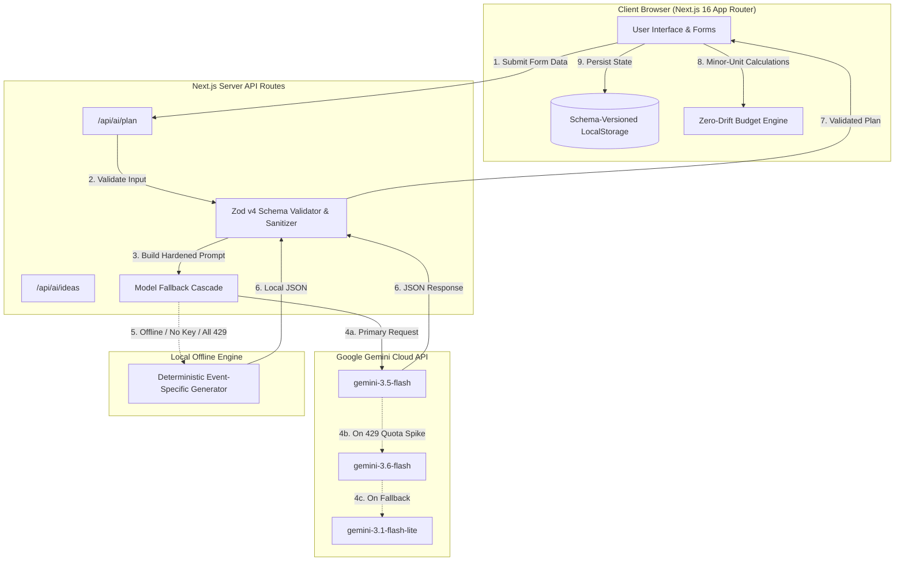

<div align="center">

# 🎊 Celebrio — AI Celebration & Event Planner

**Your celebration, thoughtfully planned.**  
*Transforming high-level dreams into realistic budgets, structured countdowns, vendor checklists, and creative inspiration — powered by Google Gemini and backed by an offline-resilient local storage engine.*

[](https://nextjs.org/)
[](https://www.typescriptlang.org/)
[](https://tailwindcss.com/)
[](https://ai.google.dev/)
[](https://vitest.dev/)
[](https://opensource.org/licenses/MIT)

[Features](#-key-features) • [Architecture](#-architecture--data-flow) • [Tech Stack](#-technology-stack) • [Getting Started](#-getting-started) • [AI Integration](#-gemini-ai-orchestration) • [Tests](#-automated-testing-suite) • [Security & a11y](#-security--accessibility)

---

</div>

## 📖 Table of Contents

- [Overview & Problem Statement](#-overview--problem-statement)
- [Key Features](#-key-features)
  - [1. 4-Step Guided Event Wizard](#1-4-step-guided-event-wizard)
  - [2. Intelligent Event Workspace](#2-intelligent-event-workspace)
  - [3. Zero-Drift Financial & Budget Engine](#3-zero-drift-financial--budget-engine)
  - [4. Chronological Milestone & Task Manager](#4-chronological-milestone--task-manager)
  - [5. Vendor Procurement & Quotation Pipeline](#5-vendor-procurement--quotation-pipeline)
  - [6. Sparkle Idea Studio](#6-sparkle-idea-studio)
  - [7. Data Portability & Clean Export](#7-data-portability--clean-export)
- [Architecture & Data Flow](#-architecture--data-flow)
- [Technology Stack](#-technology-stack)
- [Project Structure](#-project-structure)
- [Gemini AI Orchestration](#-gemini-ai-orchestration)
  - [Structured JSON Schema Enforcement](#structured-json-schema-enforcement)
  - [Multi-Model Automatic Cascade](#multi-model-automatic-cascade)
  - [Graceful Local Fallback Engine](#graceful-local-fallback-engine)
- [Getting Started](#-getting-started)
  - [Prerequisites](#prerequisites)
  - [Installation](#installation)
  - [Environment Variables](#environment-variables)
  - [Running Development Server](#running-development-server)
  - [Production Build](#production-build)
- [Automated Testing Suite](#-automated-testing-suite)
- [Security & Accessibility](#-security--accessibility)
- [License](#-license)

---

## 💡 Overview & Problem Statement

Planning an event — whether an intimate 10-guest birthday in Sitamarhi, a 150-guest beach wedding in Goa, or a large-scale college cultural festival — is notoriously stressful:
- **Financial Ambiguity**: Spreadsheets suffer from floating-point rounding errors and lack real-time categorization.
- **Timeline Friction**: Tasks are disconnected from actual calendar dates and vendor lead times.
- **Vendor Chaos**: Quotes, contact notes, and booking statuses get scattered across chat apps.
- **Generic AI Advice**: Standard LLM prompts return vague essays rather than actionable, structured execution plans.

**Celebrio** solves this by providing a unified, full-stack orchestration platform. It merges Google Gemini's reasoning capabilities with structured schema validation, precision minor-unit currency calculations, and a self-healing local storage engine that works seamlessly **online and offline**.

---

## ✨ Key Features

### 1. 4-Step Guided Event Wizard
- **Step 1: Event Essentials**: Event name, celebration type (`wedding`, `birthday`, `engagement`, `anniversary`, `community`, `college-festival`, `meetup`, `cultural-gathering`, `other`), target date, expected guests, and venue type (`indoor`, `outdoor`, `mixed`).
- **Step 2: Budget & Priorities**: Total budget with multi-currency support (`INR ₹`, `USD $`, `EUR €`, `GBP £`, `CAD $`, `AUD $`), budget flexibility (`strict`, `moderate`, `flexible`), and weighted spending priority selection.
- **Step 3: Curated Style & Nuance**: Theme keywords, style adjectives, custom color palettes, dietary restrictions (vegetarian, vegan, Jain, halal, kosher, gluten-free), cultural rituals, accessibility needs, and weather backups.
- **Step 4: Review & Generate**: Instant review card with one-click generation via Google Gemini or local demo fallback.

### 2. Intelligent Event Workspace
- **Real-Time Planning Progress**: Computed dynamically from completed tasks, vendor booking confirmations, and budget allocations.
- **Days-to-Event Countdown**: Live countdown badge (`X days left` or `Past event`) with contextual warnings.
- **AI Concept Showcase**: Curated theme statement, color palette swatches with hex codes, and contingency plans.
- **1-Click Regeneration**: Regenerate or update AI plans directly from the event workspace at any time.

### 3. Zero-Drift Financial & Budget Engine
- **Minor-Unit Arithmetic**: All monetary values are internally tracked as **integers** (paise/cents), completely eliminating IEEE 754 floating-point inaccuracies.
- **KPI Metrics**: Total Budget, Planned Allocations, Actual Spend, and Remaining Funds computed on every keystroke.
- **110% Guardrail Scaling**: If an AI-generated or custom budget exceeds user limits by more than 10%, an automated scaling algorithm proportionalizes category allocations.
- **Interactive Line Items**: Add, edit, and delete budget line items with payment status lifecycle tracking (`unpaid`, `partially-paid`, `paid`).
- **Category Visualization**: Visual progress bars displaying budget distribution across Venue, Catering, Photography, Decor, Entertainment, etc.
- **CSV Export**: Instant 1-click tabular export of budget data.

### 4. Chronological Milestone & Task Manager
- **Critical Path Timelines**: Pre-populated tasks counting backward from event day based on actual logistics requirements.
- **Priority Filtering**: Filter by `critical`, `high`, `medium`, and `low` priorities.
- **State Toggles**: Check off tasks as completed, triggering real-time recalculation of the event's overall progress score.
- **Overdue Task Alerts**: Urgent alerts highlight uncompleted tasks whose due dates have passed.

### 5. Vendor Procurement & Quotation Pipeline
- **Category Pipeline**: Pre-populated vendor categories with lead time recommendations.
- **Status Lifecycles**: Track vendors through five stages: `to-research` ➔ `contacted` ➔ `quoted` ➔ `booked` ➔ `declined`.
- **Quotation Comparison**: Compare estimated vs. confirmed vendor quotations directly linked to event budget items.

### 6. Sparkle Idea Studio
- **On-Demand Brainstorming**: Interactive input to ask for creative activities, unique decor twists, or customized menu ideas tailored to the event parameters.
- **Estimated Cost Tags**: Every idea includes an estimated cost in the event's native currency.
- **Idea Bookmarking**: Save favorite suggestions to the persistent event record.

### 7. Data Portability & Clean Export
- **1-Click JSON Backup & Restore**: Export individual events or the entire database to JSON; import backups with automated ID deduplication and schema validation.
- **Print / PDF Optimized View**: Custom CSS `@media print` rules clean up UI controls and render a formal, executive summary document ready for printing or PDF export.

---

## 🏛️ Architecture & Data Flow



---

## 🛠️ Technology Stack

| Layer | Technology | Purpose & Rationale |
|---|---|---|
| **Framework** | **Next.js 16.4.3 (App Router)** | High-performance React server components with Turbopack bundler. |
| **Language** | **TypeScript 5 (Strict Mode)** | End-to-end type safety, strict null checks, and robust data interfaces. |
| **Styling** | **Tailwind CSS v4 + PostCSS** | Modern CSS theme tokens with high-contrast, accessible HSL color palettes. |
| **Icons** | **Lucide React** | Accessible, lightweight SVG icon suite. |
| **AI Integration** | **@google/genai SDK** | Native Google Gemini SDK using `gemini-3.5-flash` with structured JSON output mode. |
| **Data Validation** | **Zod v4** | Strict schema validation, sanitization, and URL security protocol filtering. |
| **Unit Testing** | **Vitest 5 + JSDOM** | 135 fast unit tests covering calculation precision, migrations, and fallback logic. |
| **E2E Testing** | **Playwright** | Full browser workflow verification across Chromium. |

---

## 📁 Project Structure

```
celebrio/
├── src/
│   ├── app/
│   │   ├── api/
│   │   │   └── ai/
│   │   │       ├── plan/route.ts      # Server-side Gemini plan generation & cascade
│   │   │       └── ideas/route.ts     # On-demand creative brainstorm API
│   │   ├── events/
│   │   │   ├── new/page.tsx           # 4-step event creation wizard
│   │   │   └── [eventId]/page.tsx     # Full interactive event workspace
│   │   ├── globals.css                # Design system tokens & utility classes
│   │   ├── layout.tsx                 # Root layout with font imports & skip-to-content
│   │   └── page.tsx                   # Main dashboard, KPI cards, & upcoming tasks
│   ├── lib/
│   │   ├── ai/
│   │   │   ├── demo-fallback.ts       # Offline event-specific plan generator
│   │   │   └── prompts.ts             # System prompt engineering & JSON schemas
│   │   ├── calculations/
│   │   │   └── budget.ts              # Integer minor-unit currency calculations
│   │   ├── schemas/
│   │   │   └── validation.ts          # Zod validation schemas for all entities
│   │   └── storage/
│   │       └── storage-service.ts     # Versioned localStorage with self-healing
│   └── types/
│       └── event.ts                   # Core TypeScript types and enum constants
├── tests/
│   ├── e2e/
│   │   └── event-planning.spec.ts     # Playwright E2E browser tests
│   ├── unit/
│   │   ├── budget.test.ts             # 50 tests for financial arithmetic
│   │   ├── demo-fallback.test.ts      # 13 tests for offline generator
│   │   ├── schemas.test.ts            # 47 tests for Zod schemas & URL safety
│   │   └── storage.test.ts            # 25 tests for storage CRUD & migrations
│   └── setup.ts                       # Test environment setup
├── .env.example                       # Example environment variables
├── next.config.ts                     # Security headers & Next.js config
├── package.json                       # Project dependencies and scripts
├── playwright.config.ts               # Playwright test configuration
├── postcss.config.mjs                 # PostCSS configuration for Tailwind v4
├── tsconfig.json                      # Strict TypeScript compiler options
└── vitest.config.ts                   # Vitest unit test runner config
```

---

## 🤖 Gemini AI Orchestration

Celebrio uses Google's official `@google/genai` SDK with comprehensive resilience layers:

### Structured JSON Schema Enforcement
Requests specify `responseMimeType: "application/json"`. The prompt enforces an explicit JSON structure containing:
1. `eventSummary`: 2–3 sentence executive summary.
2. `concept`: Name, description, hex color palette, and cultural/aesthetic rationale.
3. `budget`: Array of categories with minor-unit estimated amounts and allocation justifications.
4. `timeline`: Chronological preparation tasks with deadlines counting backward from event date.
5. `vendorChecklist`: Recommended vendors with category tags and suggested procurement lead times.
6. `ideas`: Creative activities and thematic enhancements with estimated costs.
7. `contingencies`: Risk factors paired with actionable mitigation protocols.

### Multi-Model Automatic Cascade
To prevent service interruption during peak demand or Free Tier rate limit spikes (`429 RESOURCE_EXHAUSTED`), the server cycles through a candidate model cascade:
```typescript
candidateModels = [
  process.env.GEMINI_MODEL || 'gemini-3.5-flash',
  'gemini-3.5-flash',
  'gemini-3.6-flash',
  'gemini-3.1-flash-lite',
  'gemini-flash-latest',
];
```
If the primary model returns a quota or rate limit error, the request automatically tries the next model in the list.

### Graceful Local Fallback Engine
If no Gemini API key is configured or all external network calls fail, Celebrio's local fallback engine ([`src/lib/ai/demo-fallback.ts`](file:///d:/challenge%205/celebrio/src/lib/ai/demo-fallback.ts)) generates realistic, event-specific plans tailored to the exact event type, guest count, and budget. The UI transparently labels the result as **`Demo Plan`** or **`Gemini AI`**.

---

## 🚀 Getting Started

### Prerequisites
- **Node.js**: `20.x` or later
- **npm**: `10.x` or later

### Installation

```bash
# Clone the repository
git clone https://github.com/your-username/celebrio.git
cd celebrio

# Install dependencies
npm install --legacy-peer-deps
```

### Environment Variables

Celebrio works out-of-the-box without an API key using the local generator. To enable real Google Gemini AI generation:

```bash
# Create local environment file from template
cp .env.example .env.local
```

Edit `.env.local`:
```env
# Google Gemini API Key from Google AI Studio (https://aistudio.google.com/apikey)
GEMINI_API_KEY=your_gemini_api_key_here

# Recommended model (gemini-3.5-flash has fast generation and generous free quota)
GEMINI_MODEL=gemini-3.5-flash
```

*(Note: `.env.local` is already included in `.gitignore` to protect your secrets.)*

### Running Development Server

```bash
npm run dev
```

Open your browser and navigate to:  
👉 **[http://localhost:3000](http://localhost:3000)**

### Production Build

```bash
# Verify TypeScript strict types
npm run typecheck

# Build optimized production bundle
npm run build

# Start production server
npm start
```

---

## 🧪 Automated Testing Suite

Celebrio includes comprehensive automated tests covering all critical operations.

```bash
# Run all 135 Vitest unit tests
npm test

# Run Vitest in watch mode
npm run test:watch

# Run TypeScript type check
npm run typecheck

# Run Playwright End-to-End tests
npm run test:e2e
```

### Unit Test Matrix (135 Tests Passing)

```
✓ tests/unit/storage.test.ts (25 tests)
  - localStorage availability detection
  - Complete CRUD operations
  - Corrupted JSON & missing events array recovery
  - Schema version migration
  - Duplicate ID conflict resolution
✓ tests/unit/budget.test.ts (50 tests)
  - Minor-unit currency conversions (cents/paise)
  - Planned vs. actual spend variance
  - 110% over-budget auto-scaler logic
  - Dynamic planning progress percentage computation
  - Overdue task identification
✓ tests/unit/schemas.test.ts (47 tests)
  - Event basic info, budget info, and preferences validation
  - RFC4122 strict UUID verification
  - Unsafe URL scheme rejection (blocking javascript: and ftp:)
  - AI plan schema validation & color hex verification
✓ tests/unit/demo-fallback.test.ts (13 tests)
  - Event-type specific plan generation
  - Budget-aware category distribution
  - On-demand idea generation with cost estimates
```

---

## 🔒 Security & Accessibility

### Security Measures
- **HTTP Security Headers** configured in [`next.config.ts`](file:///d:/challenge%205/celebrio/next.config.ts):
  - `X-Frame-Options: DENY` (Clickjacking mitigation)
  - `X-Content-Type-Options: nosniff` (MIME sniffing prevention)
  - `X-XSS-Protection: 1; mode=block`
  - `Referrer-Policy: strict-origin-when-cross-origin`
  - `Permissions-Policy: camera=(), microphone=(), geolocation=()`
- **Server-Side API Key Isolation**: All Gemini API calls happen strictly inside server-side Next.js route handlers. The key is never exposed to client-side bundles.
- **Input Sanitization & Schema Validation**: User inputs are strictly validated through Zod v4 schemas with character-length bounds.
- **Safe URL Filtering**: Vendor websites are filtered to allow only `http:` and `https:` protocols, preventing `javascript:` XSS vectors.

### Accessibility (WCAG AA Compliance)
- **Semantic HTML**: Proper `<header>`, `<main>`, `<nav>`, `<fieldset>`, and `<legend>` landmarks.
- **Skip Navigation**: Accessible `"Skip to main content"` bypass link.
- **Screen Reader Support**: ARIA attributes (`role="progressbar"`, `role="tab"`, `aria-selected`, `aria-label`).
- **Keyboard Navigation**: Complete keyboard navigability with visible `:focus-visible` styling rings.
- **Motion Preferences**: Respects `prefers-reduced-motion: reduce` by disabling non-essential transitions and animations.

---

## 📄 License

This project is open-source and licensed under the [MIT License](LICENSE).
